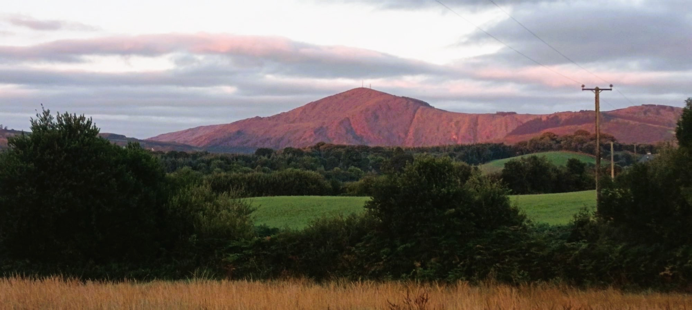
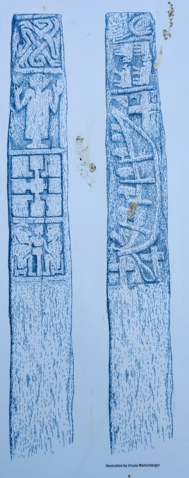
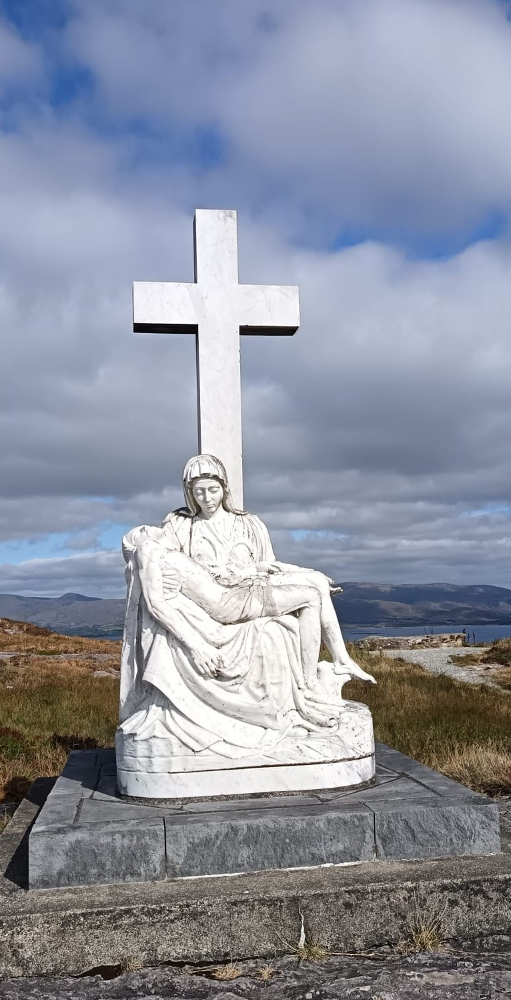

.jpeg)

I'm the only person on the square in Bantry although I'm half worried the cops will emerge from the Paddywagon yonder and rip me from the street for cooking my own breakfast. My arse is crouching off the edge of a seat and I'm leaning over a camping stove, heating up the last of a Dekker Curry made yosterday by my wife-in-law. It's a beef curry, with a roof of rice, Omani-style, filled with carrots and mild spices, subtly blended. The kind of thing that could never be bought before midday in this country. The Omanis shift a curry every day at lunchtime, often with fish and sometimes chicken but she's given up the dinosaurs as part of her latest regime. Supposably the *fibres* are too long? I had to put in a special request for a curry cos she's mostly quit vegetables and spices too. But it doesn't taste quite like it used to. Our relationship is in tatters and her head's not in it. Her cooking is mammy by numbers although it's still a shitDermot better than most people's food.

**Champagne and drop goals**

We were all here two years ago, the day that The Ginger Saviour – aka Jordie Carrot – slotted a brace of late drop goals agin The Springboks. Few phases then dropper. The place went wild. The Four of Us were in the juicer across the road along with a copula hundred other cyclists celebrating our spin out to Mizen Head. The Wild Atlantic Mizen Cycle. It was a time of togetherness, one of the last I can remember, and it's painful to think that we'll never again get to play happy family. Two parents. Two kids. One purpose. I came here to get away from it all but I've come back to the scene of the good times.



Hotel parking

 



I haven't worked out where to park yet but I'm busting for a breakfast Barry so I pull in to the Westlodge hotel and it turns out to tick a bag of boxes. There's a pool here for a wash this evening and I can always monster a Joey Carvery if I'm too rushed for Bantry banter. I order a wathery coffee and sit in an empty lounge but I'm in no mood for delay as I need to push some pedals, even though I'm curiously nervous. I could even park here for the day but I see a few lorries lodged in the hard shoulder yonder so I get in line behind them, whip out my Paul van and double back across the road to go and see the nearby Kilnaurane Stone. **EXPLAIN**

-   *I've been wanting to investigate ever since I read about it on my Mizen trip. It's only a few hundred metres away, although it's lumpy enough to warm the blood. I leave the bike at the gate and walk up an innocuous looking field where, at the crest of a mellow hill is a mansize domino, crusted and mossy, and barely revealing the carvings. **Now I've seen reconstructions of the***

-   

-   *I end up parking the car across the road, in the hard shoulder, between some likeminded truckers, then I nip back across the road towards the Kilnuarane Stone which*

Gimpy peninsula

Sheep's Head is a gimpy little peninsula sheltered between Mizen's bevelled exposure to the ocean and the rainy heights of Beara. Among Cork and Kerry's fingerlike peninsulae, Sheep's Head reminds me of the truncated ring finger of a tubist I used to know, Conor O'Riordan, who went out with my sister Maryanne, a flautist, while I was a pre-teen, and they were studying music performance together in town. Conor would sleep on the couch downstairs and honk away on his tuba all morning, unencumbered by his tipless finger; Maryanne would flit along her scales in another room, while I'd be off reading about like the history of football. World Cup 90. The Orbis Football Collection. Stickers were for saps. Some years later I went over to visit Maryanne, in London, in what turned out to be Zadie Smith's Willesden, where the two of them went to study in the Guild Hall in order to continue their careers as musicians. Conor managed to keep the dream afloat and made a life as a musician. He still plays with the Garda band, lectures in music and has managed orchestras. Maryanne pulled the plug soon after London and went back to do a Pretty huge Diploma in Chemistry and now works in a lab. The two roads taken are instructive to me because Conor stuck at it and has lived a life in his preferred career, while Maryanne and I, with abilities split across multiple fields, have both lacked a single direction and failed to live up to the expectations of our respective prodigious youths. In her bathroom for a long time sat a copy of Robert Frost's poem, *The road not taken*. I'm still trying to turn it around but it ain't easy as life complexifies and bills increase. I'm now also trying to make a living as a freelance English teacher alongside my non-jobbing writing. Somewhere in my head the two will combine as I hope to run workshops across a growing portion of the earth and write about my travels as I move.

I head out along the leaner, emptier northern side of the peninsula where diddlysquat is being done on this Saturday morning. A thin ridge runs down the spine of the whole peninsula, with most of the farmland falling on the plump southern side, along with some natural little harbours and the three villages. The northern road is often just an undulating single lane that follows the coast tightly in parts, having nowhere else to go. Early on, before I get to the coast, I pass a couple of aulflas yapping by a wall and they too are met by a trendy couple out walking their big trendy dogs. Ireland of old and Ireland anew. After that it's just me and the postman-with-a-van alternating the lead in our silent but serendipitous race to the end of the road, punctuated by the odd wavesmile. The road has some competitively steep ramps but having cycled all over Wicklow for the last eighteen months, I have developed the experience not to be burning any matches this early in the day. Plus I've built my bike for climbing, with two granny gears on the front and a saucer-sized sprocket on the back.

The view across Bantry Bay is dominated by Bere Island and Hungry Hill, a great big lump of rock whose highest points supports three whole metres of annual rainfall. Off to the right slash east of the island is a little rock lighthouse called **Roancarrigmore.** Bere Island protects the deepwater port of Castletownbere from the worst of the Atlantic Weather, and it is also the location of one of the growing number of planned out holidays upon which my friends and I did not actually embark. A few years back we could all jet off to Sicily, as a pack of eight, and saunter up Mount Etna. Nowadays, held back by responsibilities, and a pair of sprogs apiece, we can't even get together to take the ferry to Snowdonia or a car trip to Bere Island, where we were going to walk around a temperate rainforest and get a tour of a rewilding project run by Eoghan Dalton who would, later this September, be named [Cork Person of the Month](https://www.echolive.ie/corknews/arid-41916790.html).

-   For now though, our trips have been reduced to an annual #takedown at Gk's holiday home on Lough Derg and it's becoming a tradition that we go there for the Six Nations Super Saturday. Last year we all climbed aboard his scutty little vessel and buzzed over from the forgotten serenity of East Clare to the wealthier Tipperary side of the lake which soaks up holiday folk from North Munster and Rest of Leinster. We had a saunaswim combo in Dromineer, watched the rugbo downlake in Garrykennedy, and motorboated back to watch England and France rack up a hundred nearly points between them before mercifully saving Ireland from the inflating pressure of spending the latter stages of yet another World Cup cycle being Six Nations champions.

I eventually come to a junction of sorts with the 'main' road, known as the Goats Way, curving up and over Seefin Pass and signposts pointing right towards a rough track that I wouldn't be braving on my road bicycle. The signs are surely aimed at hikers for whom this scraggy land is supposedly ideal, being crisscrossed with an 88k network of paths, and the area has won multiple awards for sustainable tourism. Of course it is not the scragginess alone which draws them in but the reduced intensity of modern life caused by the peninsula's low concentration of worthwhile farmland. This absolves the terrain from supporting rapacious settled humans, freeing it up for walkers and, to a lesser extent, cyclists. I'm reminded of Knockadoon Head in East Cork where a notice explained how sea cliffs are one of the few terrains that man has not been able to conquer, allowing birds to prosper. I'd imagine the sea birds of Skellig Michael Mór mustabeen well miffed when early Christians monks decided to set up an offshore outpost for their prayer. God only knows when I'll get there again now that winter is coming. It was, incidentally, part of our first trip as a group of hashtag lads back in 2014, and Mono brang his mortifying lightsaber on the boat because a scene in Star Wars was shot on the island.



The pass over Seefin Hill gives spectacular views all round and it is a stop-off point for drivers along the Wild Atlantic Doris. Northward is the same view across the wide Bantry Bay that I've been gawking at for long enough, but now southwards I can see over lush farmland, the narrow Dunmanus Bay, and nearby Mizen Peninsula. The sun illuminates the land and the grass really is greener. The site is marked in the most bizarre, most Irish way possible, with a copy of Michaelangelo's sculpture *La Pieta*, **erected in the 1960s as a homage to someone's father**. Literature is a common response to this strange landscape, being an odd mix of liveable and unbearable. A notice mentions that *Hungry Hill* is the name of a novel by Daphne du Maurier, so afterwards I go all Paul Theroux on the matter and I hunt down and read the book. The novel was published in 1943 and [adapted for film](https://www.youtube.com/watch?v=Wy597POPKQk&t=224s) in 1947, but it is set throughout the nineteenth century, following successive generations of a West Brit family who set up a copper mine on the hill and import labour from Cornwall, where Du Maurier spent much of her life. The plot is modelled on a true story she heard from a friend and, while there is detailed familiarity with the inner and outer lives of the protaganists – I got through Copper John and Greyhound John before the law of diminishing returns took over – there's nighon zero understanding of the lives of local Irish or even the Cornish miners. The obvious analysis[^1] has been to castigate Du Maurier for her limited depiction of these groups but, having failed to complete an historical novel myself in the last year, I can appreciate just how difficult it is to try and recreate more than a tiny segment of a past society. Verisimilitude requires detail. What brand of tea did each social group drink? What would they sing to soothe their children back to sleep?

[^1]: <https://gorryresearch.ie/2022/01/06/hungry-hill-daphne-du-mauriers-fantasy-ireland/>

[David Mitchell's](https://en.wikipedia.org/wiki/David_Mitchell_(author) "David Mitchell (author)") 2014 novel [*The Bone Clocks*](https://en.wikipedia.org/wiki/The_Bone_Clocks "The Bone Clocks"), is also set on Sheep's Head, at least its final section, although he too never bothered to actually come here, preferring to use Google Maps as his aid. These writers must have extraordinary powers of imagination. Surely the geography itself is the most outstanding characteristic of this place and needs to be experienced in the flesh, unlike perhaps some nondescript flatland hamlet. **It turns out that Peter Somerville did do this, cycling around West Cork and** [publishing his account](https://roaringwaterjournal.com/2025/12/07/peter-somerville-large-and-the-coast-of-west-cork/) **in 1972.**

A German and his dog are here to enjoy the view but not the chat so I zip down the winding descent and into the back of Kilcrohane village, the last of the three. This was the base from which Sheep's Head lighthouse would be built in the 1960s. Materials were driven here and then helicoptered to the site of the lighthouse across over 250 journeys. The village retains a little of the world I grew up in, with handdrawn sign outside shops. An information shop is open and retired lady, volunteering for the role, is explaining walking options to longlegged lady in shorts. I worry for her until I realise I too am in shorts and it's only going to get warmer. I've been up since 6am but it still only 10 and the village is yet to wake up. They only take cash here so the lady gives me a sticr for free.

I'm astonished to find out, a few minutes later, that the lady working in the Information Shop, drove this road only yesterday, and urged me not to cycle it back.

-   The highest point on Sheep's Head peninsula is Seefin Hill. It's an upwardcurving

-   Last year, while training for the Wicklow 200, I learnt a lot about fueling across the day. Eat early and eat often is the mantra. If you're hungry, it's too late. My YouTube coach, a foul-mouthed Scot with an aptitude for aphorism, words it thus: you're eating too much in the kitchen and not enough on the bike. His moniker is *Bulletproof Cycling* and he claims to be fifty-five, which is about life expectancy for a Weegie, although he looks little more than thirty.

-   Speaking about the Glasgow Effect, today is Liz McKenna's seventh anniversary and she'd be seventy now, according to my mother, her best friend. Liz was only sixty-three when the cancer got her, so she's among the one in four Glaswegians who die before the age of sixty-five. She grew up in the proverbial tenements with an alcoholic father and escaped to Dublin when she was seventeen. I must see if I can find her memoir which she was putting together in hospital, while also organizing her own funeral. I hadn't realised just how sick she was and I didn't go into her in the hospital until it was too late. Family only, sir. We were just becoming friends in our own right when she got sick again, and it was great to have someone in my life who was as wild and as fun as my own mother only Liz brang a different brand of love. I still keep a tiny hairbrush she gave us when our son had long toddler hair, and she gave us a mould for the six fingers on his left hand before the excess baggage was lopped off. The two of them cycled around the world together and went on religious trips too. There's a gas picture of them in Jerusalem where they went on a tour, for reasons unknown, with a busload of Nigerian Londoner Evangelicals. *Perhaps they all shared the same big loud smile.* *Liz and Mary were always the Black Sheep so perhaps they finally found their tribe.*

-   This leaves space for the little people to thrive. Walkers abound. So do old habits. Karen's pub only takes cash. The signs about the place are handwritten. The other road out here is impassable on a road bike. I was told in the tourist office but a glance from high sufficed.

<!-- -->

-   A parking lot sits at the end of the road, plenty high above the lowlying lighthouse another two walkable kilometres away. Across from the parking lot sit two stone buildings, one for filling the belly and another for emptying it. My belly is plenty full, thanks to my newfound fueling strat, so I'm only after a coffee but the doors are shut. I hide my bike round the back and sit on a picnic bench, gazing out at the Mizen Peninsula and the D'Atlantic Oshe. A man of my vintage, portly from from the rubbishness of modern life, potters over. He says he's from Notts which is a word I've never heard in isolation. J**ust Notts County or written down in the paper for the cricket results. Surely Andy Farrell doesn't tell people he's from Lancs?** So anyway I tell him I was just over in Nottingham, after a funeral in Grantham, and he says they live just half an hour away.

*unremarkably portly thanks to modern living being rubbish, **potters** over with a similar goal and he's as disappointed as me with the outcome.*

-   His dad is over at the car. He turned eighty and your man didn't know what to buy him so he brang him back to West Cork. It's a great idea and my mam did the same for her mammy when she turned eighty. I remember them taking a bus to Rome, and I realise it's time I do the same for my mother, who turned eighty-four in April. Unlike most people of her age, her health is improving, but that's because it got so bad earlier this year. She was in a car accident last December and *only* broke her leg twice and mangled her knee. She was crossing the road when a van swang round and smashed her leg goodo. In the hospital she picked up a flesh-eating superbug and had to undergo general anaesthetic twice a frikkin week for two months as they washed out the bacteria and filth. After that she got pneumonia and mustabeen no more than another mere mishap from death. But her Tourmalet lungs pulled through, the wound healed, and she came home seven months later with a leg that looks like a volcano and a knee that is reduced to a hinge. But she's on the mend and has been progressing from a zimmer frame to a walking stick and she recently took her first unaided steps. She walks up the road now and brings Jacqueline Ennis with her. Her aim now is to walk the Goal Mile at Chrimbo with all the family, just like ever other year.

They go for coffee in Marion Shine's house, recently vacated by her husband Tony who has had to move into a home due to dementia. It's a worryingly familiar story as my own father's brain health has collapsed in the absence of his wife. Me and my sisters stayed with him on rotation for the seven months, twenty-four hours at a time, while trying to juggle work and kids. Big Val's mind collapsed amidst the confusion, between our rotating presence and the never-ending supply of carers. It's at the stage now where you enjoy the lucid moments and he still has the presence of mind to pick berries with my three-year-old daughter and bring her immense joy.

So if you're wondering why I haven't been galavanting on my bike, it's because I was averaging 33 hours a week of care, intermittent visits to my mam, plus a ton of mileage, and it has been a huge relief since she came home that our role has been reduced to background support.

I told her she needs to think in terms of a fifteen year project,, which would leave her at 99. Because of the accident, I no longer think she'll hit a hundred even though I have long thought about sticking a few bob on her doing so and then collecting my winnings in 2042. I got the idea from Shane McGowan who supposably bet on himself to hit fifty and then went on a celebratory bender with his winnings.

This lad is nothing like Oskar, who was the liveliest person I've ever met and perhaps the greatest banter merchant of them all. I met Oskar while queueing up to enter the Sziget Festival

... and i've known him for twenty years but because we only saw each other every year or three it's hard to appreciate that he's gone

Roger - my mam - trip away.

### **Seefin Viewpoint**

------------------------------------------------------------------------

**Toorin parking**

The road to the cliff is another steepish yomp and when I get there I've supposedly done 670m of climbing across 33k of cycling. That's 20m per kilometre. It sounds like a 2% gradient but you're descending half the time which means you are averaging 4%. It's a higher ratio than the Wicklow 200 (17 metres per kilometer when I did it) where they go out of their way to make it hard on you. But obviously I'm used to it as I live on top of a super steep hill and getting a pint of milk from my local shop comes at a cost of 50mpk.

There's a strength-sapped cyclist getting a coffee and a scone and he's worried he won't have the energy to get back. I suggest he fuels up on more than a bun built for an aulwan's elevenses but he ignores me, and it's no wonder that his arse and legs are sagging like old glass in a church.

Thus far today, I've been keeping myself plenty fueled. I only had a couple of little bananas at 6am but at 8 I sat down in Bantry Square, whipped out my camping stove, and heated up a pint of beef curry with a roof of rice, GCC-style. On the bike, I put away three little mandarins and two more of those scutty bananas. I had a half loaf of soda bread with a big hunk of cheddar cheese (a bite of this and a bite of that). I then had a cheeky Britney cos the cafe was dunta and, along the 6k lighthouse loop, I put away a half-dozen yellow-pack hobnobs and an ellipsoid of mozzarella. Right now I have no need to fork out for crap cafe food so I get a crap coffee and plug in my dead Tony. I've also had a two litre vat of water hanging out the back of me and it too has been dunzoed.

Last year, while training for the Wicklow, I learnt a lot about fueling across the day. Eat early and eat often is the mantra. If you're hungry, it's too late. My YouTube coach, a foul-mouthed Scot with an aptitude for aphorism, words it thus: you're eating too much in the kitchen and not enough on the bike. His moniker is Bulletproof Cycling and he claims to be fifty-five, which is about life expectancy for a Weegie, although he barely looks thirty.

The lads totter on and I'm left looking for chats. There's an ageing Saxonette also looking for a coffee so I tell her she shudda brang a Britney like me. Pro Tip for lads. It turns out she's a regular in these lands and you can hear it in the lingo. She pulls out her penscratched map and walks me through her trip thus far. She started out in Cork City then she went to Clon then Ross and, just before she gets to Skibb, she checks herself and blasts out the full anapest: *skib-be-REEN*. Her mates meet up once a year or so and she's so grateful to take what few chances she has left. She has friends with dementia and they are sat in a chair waiting to die. I tell her about my dad and how he degenerated so much while my mam was in hospital for seven months and yet it is the garden which puts structure on his life. At this stage we're just thankful for what lucid moments he has left and yet the garden continues to provide structure and purpose in a life that could also be spent in a medical chair. He was in hospital with the shingles for three weeks and he was completely gone then. I remember asking the staff when he could come home and they just looked at me like I was deluded. What would a person like that be doing unaided at home? Yet with his wife beside him and his home and his garden, he's alive again.

There's only six of them left now and there used to be ten. It's not clear if all of them are Brown Bread or if we've just lost some to dementia. Her husband died when he was fifty-three. She woke up one morning and he didn't. I reckon that mustabeen twenty-odd years ago and you can see her still filling her time with trips to and fro, making a mosaic of a life in the absence of a life companion, but it's clearly keeping her lit. She totters off to the union and I plod off to lighthouse at last.

The walk to the lighthouse is two glorious kilometres in the sunshine across terrain that would be safe but slippy in the wet. It's lumpy craggy sinewy land and I feellike a spider walking along the upturned side of a damaged peat briquette. I'm wearing a pair of suede jodhpur boots instead of cycling cleats cos I actually *checked* in advance. It's an ootenacher road so there's plentyass walkers on the return leg looking delighted with their little adventure.

Sheep's Head is a walkers paradise, even for the softcockers who drive all the way here and back. The whole peninsula is the forgotten little gimpy finger with no towns or ports or prestige. This leaves space for the little people to thrive. Walkers abound. So do old habits. Karen's pub only takes cash. The signs about the place are handwritten. The other road out here is impassable on a road bike. I was told in the tourist office but a glance from high sufficed.

The lighthouse itself is only here as an aid to ships heading in to Bantry Bay

-   Whiddy Island

-   Betelgeuse 

<!-- -->

-   lake

-   yaps

-   <div>

    -   

    </div>

-   etc

I'm wearing suede jodhpur boots and I never brang my cycling cleats, thanks to advice from Lighthouse Pete.

Brown bread or dementia

Roger - my mam - trip away.

------------------------------------------------------------------------

Across the water is Bear Island and it's the closest any of my mates have ever gotten to it. The eight of us -- or some available subset -- were supposed to go there on one of our annual trips abroad. As the years went by the trips have become less exotic. The peak was a villa in Sicily underlooking Mount Etna but now we hardly even bother trying to leave Ireland. Ever since my lad popped out in 2017, all eight of us have had two kids apiece, and the logistics are too much. I think seven of us have kids under 5. The year we failed to make it to Bear Island came after the year we failed to get to Snowdonia. I'm not sure where we failed to get to last year and this year we didn't even bother trying. But we do have a regular slot in Gk's holiday home on Lough Derg, fast becoming an annual feature taking place on the last weekend of the Six Nations. It's not much but any contact with your mates en masse is to be cherished.

We had failed to get over the water to Snowdown

for a busy weekend that included a guided tour of a temperate rainforest there and a bunch of rewilding work. But Gk pulled out and maybe someone else did too and it all fell apart. Big Man musta been offski cos it was Kilroy organizing and i remember him hanging up on me because i started shouting down the phone at him. It probably wasn't even that loud by my standards, but fair focks to him cos I was obviously well out of line and too used that kind of bad behaviour. I've found myself in a relationship, and a family too, where screaming at each other is unacceptably normal and, as I write this, my chunfla is screaming at his little sister over like the remote control. I'd never normally be stroppy with my mates, at all at all, but

I shouted down the phone to Kilroy so he hung up on my immediately and it was great to have manners put on me because my relationship has been a disooster on that front since the off.

was supposed to go there a couple of years ago with the proverbial lads but it fell through, as did the trip to Snowdonia, the one to ???, and this year we didn't even bother trying to organize a big trip.

We do have a regular slot now in Gk's holiday home on Lough Derg and it's becoming a tradition that we go there for the last weekend of the Six Nations. Last year we hopped on the scutty little bowed and went over to Dromineer for a sauna and a swim before watching the match in Garrykennedy.

with a little lighthouse at either end

Google Maps sent me across a bastid of a mountain pass, perhaps to save me eight minutes on the N72, but the good news

Atta Vista

I'm gaggo for a bit of yapski and I'm wondering if I could suck the bants out of a local fisherman or something. Thus far it's been wall-to-wall touristinos. I'm a hundy pee that I'm not looking for Eileen's colourful juicer and Kilcrohane also too near my destination, so I punch on towards Ahakista and hope for the best. The southern half of Sheeps Head is the good side, with the skinny Dunmanus Bay looking over at the supine Mizen Peninsula and Ahakista is a fishing village around a bite-sized bay within the bay. The Tin Pub contains perhaps the prettiest beer garden in existence. Hanging out the back it is a good-sized lawn with a simply manicured garden broken up by a smattering of picnic benches and princely seats. Down below is the immaculate lakelike water sitting pretty amidst grungy locks of seaweed and angular rock. A scatter of boats break the surface tension and a path leads down to a lick of a beach with a few lucky swimmers. I've no towel on me but I'm thinking I might just wash myself off and then take on the juicer in wet cycling shorts.

Couples sit abreast staring at the view, saved from the stress of yammer. On a picnic bench is the father-son combo from Oskarville so I've got them in the bank if I need it but I leave them at it for now. Charlie is watching something on his Tony while Roger drinks in peace. I go on back in for a Brit Award and notice the barman is using a clipboard to obscure the GuinnGuinns tap so I order a Murphys and, as I wait, I get yapping to Roger who has come in for another gulp. His memory isn't a hundypee and frikkin borman storts picking him up on the veracity of his memobants. But he's a biter so I'm delira to soak up a few stories plucked from his thirty-thousand days on Earth. He's telling me about all the times he has been to West Cork and that he was here with Wendy, what thirteen years ago, because it's been ten years since she died. His face droops at the memory of her passing and you just want to squeeze his hand and give him just one of the several thousand he hasn't had this past decade. Jaysus I remember years ago being out in Morningside with Malco the Alco and we had a skinnapints with Wendy the Widow – no relation – and then we saw her to the bus and I've never forgotten how tight she squeezed my hand with the loneliness.

-   I join the lads and Charlie is watching Forest while I quiz Roger.

<!-- -->

-   It turns out he spent decades working around the Middle East building the military bases that are being blown up as we speak. He hasn't been to Oman a lot but he's working hard to fill in my questions.

<!-- -->

-   They were in Dubai in '78 and they were just opening up the school that Charlie and his brother went to. The Headmistress literally requested a plot of land of the government and was granted it. Even now, in Oman at least, they give a plot of land to a lad when he hits 21. The wife never got one of course as she would be expected to avail of her husband-to-be's allocation. She also got fock all of her inheritance from her mother's sudden death. They have a much fairer way of divvying up wealth, with different levels of relatives getting specific allocations. Of course sons get double what daughters get, yet half a loaf of bread is better than none at all, as is often the allotment here.

    -   The mother-in-law (new name needed) certainly had her plots but now

    -   Her mother's story alone is that of the country in miniature. In the mid-70s, she and her sister were the first girls in their area to go to primary school and they had to thumb a lift every day. She ended up a schoolteacher herself and latterly worked in the Department of Education.

    -   The country underwent enormous changes, seemingly more than anywhere in the world in that half century and her own story tells you the recent story of Oman in miniature.

    -   Her father was a magic man, with a parrot on his shoulder, access to Genies and actual shedloads of recipes and potions. People would come to him for the good of their own health *and* the ill health of others.

    -   He had ancients texts and papers that have mostly been destroyed through shame as the people have lost their old customs in favour of a fortified Islam, Ibathi in name, slightly distinct from Sunni and Shi'a.

    -   

-   I told Roger about the situ with Sharifa's family and his response was to say that things were very tribal out there. He said he wouldn't know how things were done in Oman but he told me a good one about Amman in Jordan, about working as a peacemaker between a local tribe leader and his crew of workers.

    -   Roger was the manager of a building operation of the kind that the Iranians have been thankfully obliterating in recent months as part of *their* Special Military Operation.

    -   because his worker, while driving at night, killed a local man. When the police came the worker tried to explain that he thought he hit a donkey but the cops took this as a slight and thing went south from there.

        -   didn't like the insinuation that one of theirs was being called a donkey. So the

        -   I couldn't follow every detail but long story short the resolution was that the agreed upon solution - a bag of cash – was twisted and the local leader gave the cash back to the family of the worker who killed the man!

    -   Every one of Roger's stories involves a bag of pints even the ones where he was reported by a neighbour for dangerous driving even though he was on the Zeroes. I soon realise that this arrangement of an interview over pints could go on for hours yet so I elect to not have another and I hit the road.

-   Religion in England

    -   I'm curious about when religion fucked off out of England and the lads have the timeline down. C

-   All Irish people are rogues

    -   memory of the IRA over 50s now

    -   Quiz him about Irish people in the community but there seem to have been fock all, just one oddball family round the corner with iconography dangling off the windows, and some other unremarkable family.

    -   so he was basically just inherently prejudiced.

-   They defo enjoyed my rant about growing middle-class racism. Indians in Dubai. You think you've got a lot of Indians!

-   Cricket, head injuries

-   Charlie wasn't one bhit intersted but he was low priority for me

-   

-   So this local

-   Back then it was a privilege to be a Brit in the Middle East but now it no longer is.

-   I explain they ought to be drinking Murphys or Beamish in this neck of the Keith Woods

-   He's trying to fill me in on what he has from Oman but its not a lot. He was in Dubai in 78 and his telling me about the school that Charlie went to becasue they'd just be given a plot.

<!-- -->

-   it's a practice that continues to this day

-   i love a good detail

-   The mother in law certainly had her plots but none of them survived teh will because your man yoinked the lot

-   A few weeks back Sharifa received about 5k The was a point where i thought she could be due a gaff or three

------------------------------------------------------------------------

**Starting**

All the same, I'm Hankers and I've not eaten since I woke up in the boot of my long new car, at six in the yay Em, on the side of the Dermot in Beál na Bláth. I had to drive across a long and windy mountain pass and, reflecting the molten sunrise sky, Mount Gabriel looked like Ayers actual Rock.

I had to put in a special request for a curry becasues

often cook fish curry and she used to do chicken curry but she won't eat dinosaurs no more because of her special diet. I had to put in a special request for one of her curries because she's quit vegetables and spices and anything that is designed to make digestion hard.

It's not her best effort. She

It's not clear exactly when her efforts stopped completely but it was some time since we were last here in Bantry Square, two years ago, all four of us, playing happy family. Things were yet problematic, but some of it was positive or functional. It was mostly a lie but one we could still live with.

Another landmark in my head was the Wicklow 200 trip in June of last year. She made the effort to bring the kids to come and cheer me on, but I remember stopping in the car and she was in one of those moods that makes everyelse's mood bad. Later that day I saw out the last sixty k with a young wan and I dreamt of being with someone other than my wife. Someone I could enjoy my life with. Someone I wasn't scared of. Someone who didn't hate me.

So it must have been some time after that. Last autumn she worked shifts, four days on, four days off. I was thinking

I managed to drag her out for lunch with me once but even that was a disooster and it never happened again. She mostly stopped coming to see my parents. Wasn't arsed. Always stoned. Wake and bake. Did what she had to. Of course she'll be quitting the smoke now that I've pulled the plug again.

I can't count the number of times I've broken up with her but this is the one. I don't know what I'm going to do but at least there is a house for the kids, whatever arrangement we come to in the end.

------------------------------------------------------------------------

Bantry Trip 2024

I never know that this trip would be a chart of our marital breakdown but coming back to Bantry

-   perhaps a Dead Cat Bounce of sorts? rofl

    -   But I remember being in Knockadoon and having little good say about her after when writing

    -   We learnt how to live together and raise our kids together but we just never had the craic together - the right chemistry

    -   I used to have a running joke- do you you remember when we used to laugh' but it was only funny, blackly so, beacuse we never used to laugh. We never had much of a honeymoon period.

    -   I broke up with her like six months after we first started going out together and immediately she was off with some Italian fella

-   Timeline

    -   2014 April: started dating

    -   2014 Sept: started relationship after summer

    -   2015 may - june: I go to Spain after our first break up.

        -   comes back and sexes me up and that's the relationship back on track. So for eleven years I let myself do that. Fuck my life. It happened every time.

    -   2015 Aug: Sharifa comes from Oman (she mustabeen at home?) and moves to Sligo

        -   So what

    -   2016 Sept: Sicily trip.

        -   how did she get the visa?

        -   Visa thanks to the Italian fella i think so when was it that we broke up?

<!-- -->

-   she was back smoking but maybe just the evenings (after breastfeeding Dudu to bed

-   And I'll look back and realize I'll never have that again. A(n almost) happy family. Two parents. Two kids. One team. Shared purpose.

-   A red cunthair

    -   Watch NZ v SA this avo?

-   Book parts

    -   Family / Together

    -   Solo / Apart

        -   but I was already apart,

        -   We were never together. I'd be up early she'd be still in bead

        -   when she woke up I'd sandblast her with my energy

-   0800 I'm too scared to start cycling. Nervous. My body and mind know what's ahead. Going deep.

-   Sheep's Head

    -   Ootenbacher from the village

        -   other road impassable nigh on, the last survivor of the old times before main roads etc

        -   peninsula and old way

            -   pub only takes cash (although they shouldn't say that cos it put me off returning).

            -   handmade signs for everything, like the 90s or whatever

    -   Lighthouse

        -   like Black Head,

        -   bit ugly, needs some colour, no cottage for the keeper

        -   materials shipped in

        -   a non-human place. It's not the same as showing up to a place with a gaff knowing that some bastid had to live here and some kids had to grow up on this rock

        -   Good to be back though

        -   View of Bull Rock beyond Bearas\]

        -   \]

        -   \]

-   Insert image + explanation etc.

I stumble across the Westlodge

-   Coffee, parking for later, pool for a wash,

```         
-   place is dead – seems that it's full of line dancers who musta gone to bed late
```

-   So I park across the road and nip back the wrong way to the Kilnuarane Stone which is only a few hundred metres, although it's lumpy enough to warm up the blood.

-   I leave the bike at the gate and walk up an innocuous looking field where, at the crest of a mellow hill is a mansize domino, crusted and mossy, and barely revealing the carvings FROM...

A parking lot sits at the end of the road, plenty high above the lowlying lighthouse another two walkable kilometres away. Across from the parking lot sit two stone buildings, one for filling the belly and another for emptying it. My belly is plenty full, thanks to my newfound fueling strat, so I'm only after a coffee but the doors are shut. I hide my bike round the back and sit on a picnic, gazing out at the Mizen Peninsula and the D'Atlantic Oshe. A man of my vintage, portly from from the rubbishness of modern life, potters over. He says he's from Notts which is a word I've never heard in isolation. Just Notts County or written down in the paper for the cricket results. Surely Andy Farrell doesn't tell people he's from Lancs? So anyway I tell him I was just over in Nottingham, after a funeral in Grantham, and he says they live just half an hour away.

-   There's not much going on other than me and the postman having an unplanned race. Eventually I pass a couple of aulflas yapping by a wall and they are met by a trendy couple out walking their trendy big dogs. Your man has a big lumberjack shirt on him and I'm guessing they've moved her for the #experience.

<!-- -->

-   

<!-- -->

-   

-   The only other **identifiable life** is a hashtag commercial vehicle out getting maybe milk and the possibly paper. Downroad it's parked aloft

-   Riaview

-   Glenview Glazing or something as I see further then

-   Fishing village

-   Some very steep ramps but I have the gears and the experience and I know not to be burning any matches. I don't have endurance miles in my legs this year

corner ocean frontage

of Mizen and the grandeur of Beara. It is also less windbattered and rainy

which overbear it and keep it sheltered somewhat from the Atlantic. It reminds me of the truncated ring finger belonging to tubaist, Conor O'Riordan,

Conor O'Riordan's ring finger

-   The sun is still low and the taller hedges have me in the shade.

-   A chance to test out some videos and commentary

-   There's not much going on other than me and the postman having an unplanned race. Eventually I pass a couple of aulflas yapping by a wall and they are met by a trendy couple out walking their trendy big dogs. Your man has a big lumberjack shirt on him and I'm guessing they've moved her for the #experience.

-   The only other **identifiable life** is a hashtag commercial vehicle out getting maybe milk and the possibly paper. Downroad it's parked aloft

-   Riaview

-   Glenview Glazing or something as I see further then

-   Fishing village

-   Some very steep ramps but I have the gears and the experience and I know not to be burning any matches. I don't have endurance miles in my legs this year

Not much is

Kilnuarane Stone --\> short trip

Warm wet winters

Sheep's Head is a walkers paradise, even for the softcockers who drive all the way here and back. The whole peninsula is the forgotten little gimpy finger with no towns or ports or prestige.

Running order

Inspo –\> possibly belongs on the interim chapter.

-   It's two years since I was in Cobh on a day that Rashidat and Sharlene Mawdsley were winning medalsin the athletics and

-   I was back watching Rhasidat the other day struggling to keep a hold of her undestandably emotions and she was on about getting the chance to do what she's best at, so I just thought it's time I get back on it.

-   Kip in the car, air mattress fits, i've forgotten to bring a duvet so I stopped off in Second Fidl and found myself a light Gilet and a double duvet set I could do with so that'll have to be my blankets for the night.

-   Normally West Cork would seem like

-   The diesel's ten yooro the sgallon so I get myself a supeen to keep my tickin til i find somewhere where it's only 9.

-   Ayers Rock slash

-   Back in Ballylickey, feels like that was the last time we were back together as a family and I'm wondering when it was that Sharifa fully checked out, and my voice is warbling as I recall the holiday we had here two years ago

-   Finally some houses with colour as I enter Bantry even if it is only arid pastels that lack the gaucheness of the

-   I think of myself as my wife and my son but here's another person, my daughter who's three,

-   On bhfarraige

    -   living from the sea

    -   Irish words, does Manchan Magan

<!-- -->

-   The things you think about when you are splitting up with your wife.

    -   I toook a picture my daughter and the cat with the new car and the tree in the background.

    -   and i'm adding up what will or won't be in my life going forward

    -   

    -   

    -   

-   0849 Kilnaurane stone

-   It's lumpier

-   I'm a different kind of cyclists now. I'm already on the bananas and I've a fuck ton of food in my pockets. I'm not gonna wait til I get there to eat

    -   wicklow 200 training

    -   bulletproof cyclln

Walking

-   Among those responsible for establishing the Sheep's Head Way were Tom Whitty, an American, local farmer James O’Mahony, and Jim Leonard. [https://en.wikipedia.org/wiki/Sheep's_Head](https://en.wikipedia.org/wiki/Sheep's_Head)

<!-- -->

-   I'm starting to think I\@m in a race against the postman.

Sheeps Head mines

-   <https://thesheepsheadway.com/heritage-history/heritage_sites/gortavallig_mine/>

-   <https://roaringwaterjournal.com/2017/05/28/sheeps-head-searching-for-cornish-miners/>

    -   "Thomas arrived home from work late one night, and undressed in the dark and then found somebody in bed with his wife.  Hurriedly he dressed again and slipped out.  He then discovered that he had put on the other man's trousers and that the pockets were full of money.  Thus financed he abandoned Cornwall and wound up in Coosheen."

-   <https://aceh.ie/copper-mine-museum/> Allihies

-   , 22 August, 2026

Seefin

<https://thesheepsheadway.com/trails/western-trails/seefin_loop/>

<https://www.discoverireland.ie/cork/sheep-s-head-seefin-loop>

A writer can only gather enough information about a very limited subset of the past world they are writing s

As for David Mitchell..

it lacks intimacy with the locals and the locality, and even the Cornish miners.

opper John is a pigheaded entrepreneur who sets up the enterpris

but the tragedy from our point of view is how unimportant the landscape is

-   

went over to Dromineer for a sauna and a swim before heading to Garrykennedy to watch Ireland devour Scotland. **On Bere Island we were going to visit a temperate rainforest and explore a rewilding project...**

**More description of the road from notes needed.**

David Mitchell has neverf been to sheep's head - he wrote it from Google Maps

<https://www.vulture.com/2014/08/david-mitchell-interview-bone-clocks-cloud-atlas.html>

seems the same with Daphne Du Maurier.

-   Seefin viewpoint

-   Hungry Hill

My memory of the landscape has been weakening although I feel I ought to describe it a little more given how its use in literature is often from people who have scarcely been there, if at all.

-   

    -   Sheep's Head features as a central location in being referenced throughout and providing the setting for the book's final section. A character in that section, Mo Muntervary (also a main character in Mitchell's debut novel [*Ghostwritten*](https://en.wikipedia.org/wiki/Ghostwritten_(novel) "Ghostwritten (novel)")), takes her surname from the headland. [https://en.wikipedia.org/wiki/Sheep's_Head](https://en.wikipedia.org/wiki/Sheep's_Head)

-   EXPLAIN CYCLING SECTION AS VIDEOED

    -   with fields for grazing being scarce on the ground

What's more disappointing perhaps is the lack of engagement with the geography. The landmass is still the same now as it was in Du Maurier's time a hundert year ago and when Copper John starting mining two hundert year back. The climate hasn't changed – even though the weather never stops changing. **EXPLAIN MORE**

------------------------------------------------------------------------

(Sheep's Head microclimate? Ferns brown early? Heather yellow and purple
